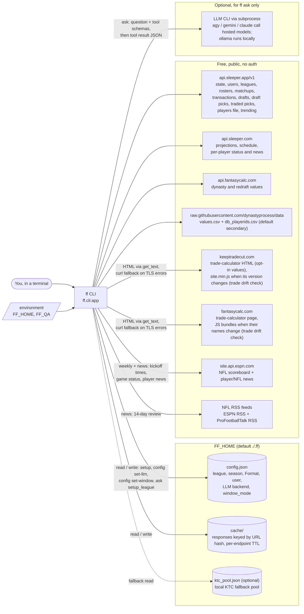
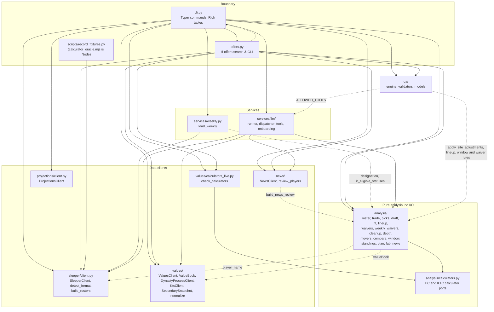
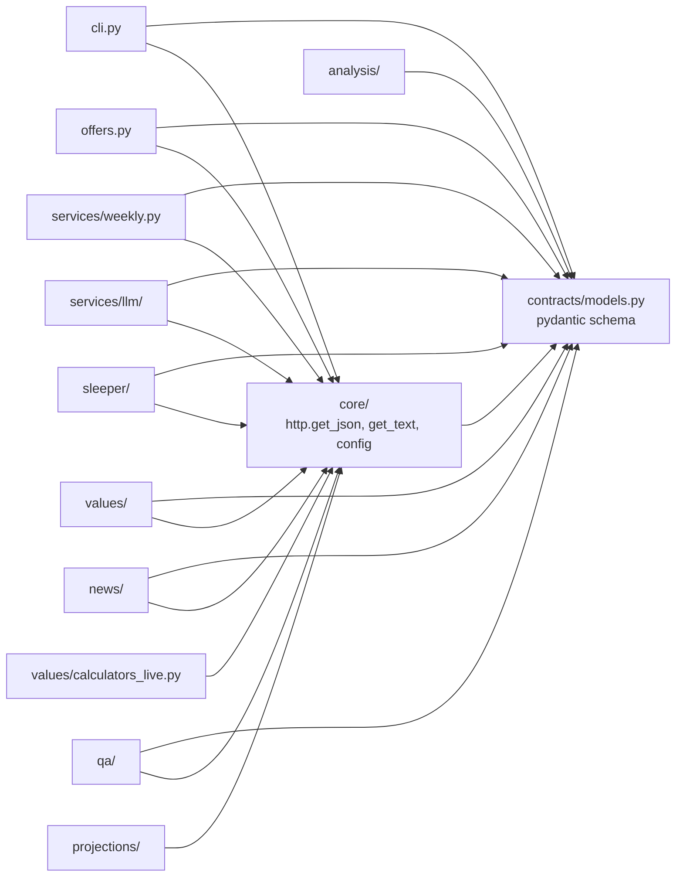
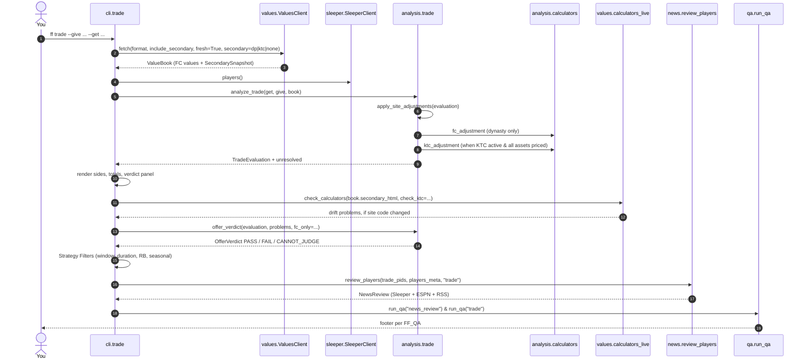
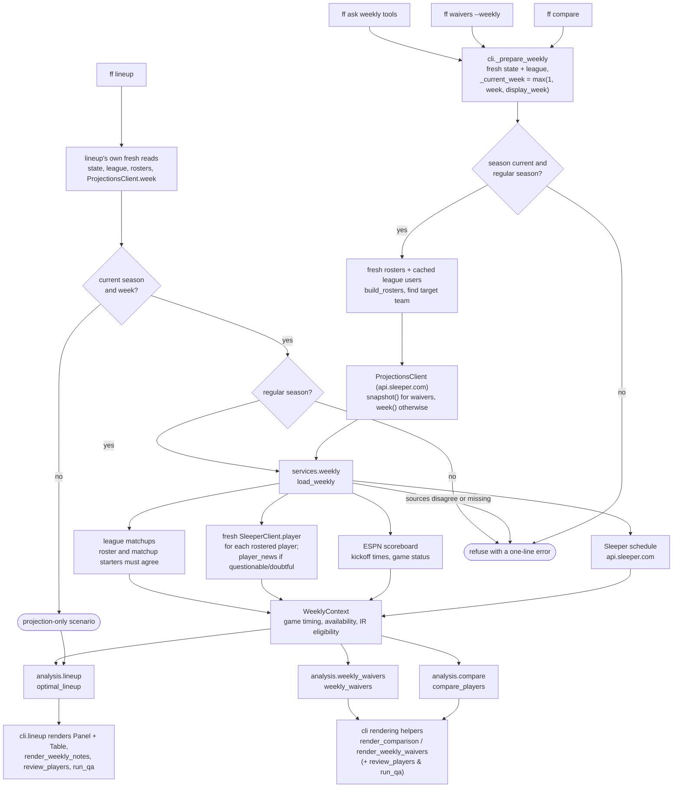
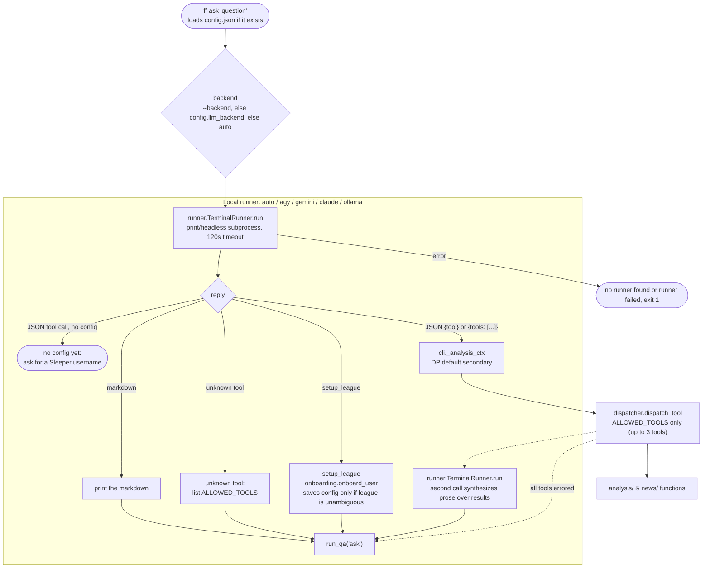

# Architecture diagrams

How `ff` is put together, from the outside in. These diagrams were derived from the source at the `v0.1.0` release baseline. Node labels use real module and function names, so you can grep them, and a rename should update this file. For the prose version and design decisions, see [`AGENTS.md`](../AGENTS.md) and [`.ai/specs/system-architecture.md`](../.ai/specs/system-architecture.md).

1. [System context](#1-system-context): what `ff` talks to and what it stores
2. [Module dependencies](#2-module-dependencies): the import graph between packages
3. [Command map](#3-command-map): which analysis each command runs and which providers it reads
4. [`ff trade`](#4-ff-trade): fresh prices, site adjustments, the offer rule
5. [Weekly decisions](#5-weekly-decisions): `lineup`, `compare`, `waivers --weekly`
6. [`ff ask`](#6-ff-ask): the local-runner path

## 1. System context

`ff` is a local CLI. Every provider call is an HTTP GET. No command writes to Sleeper: nothing submits claims, changes lineups or executes trades. CLI state is local files under `FF_HOME`. (`scripts/record_fixtures.py` writes to `samples/`, outside it.)

## 2. Module dependencies

Package-level `import` edges under `src/ff/` and `scripts/`, read from the AST: every edge drawn has a backing import, and every import is drawn. The intended layering is boundary → services → data clients → pure analysis, with `qa` as a checker beside analysis and everything resting on contracts and core. Dashed edges are couplings that cut across that layering:

- `analysis` reaches back into `sleeper` (`player_name`) and `values` (`ValueBook`) for convenience
- `services.weekly` is a data loader, yet it reuses two rules from `analysis.cleanup`: `designation` and `ir_eligible_statuses`
- `news` fetches RSS/JSON feeds and calls `analysis.news.build_news_review`
- `qa` re-runs `analysis.trade.apply_site_adjustments`, reuses lineup, window, and waiver rules (`SLOT_ELIGIBILITY`, `game_locked`, `unavailable`, `waiver_positions`), and reads the `services.llm.tools` allowlist
- `ff/offers.py` imports `cli` helpers (`_pick_window`, `_season_sim`, `_finish_ranks`, `render_news_review`, and `cli.console`)

`values/dealer.py` is a backward-compatibility shim that no command imports.

<!-- edges:begin -->

Nearly every package also imports `contracts` and `core`. They are drawn separately so the graph above stays readable:

<!-- edges:end -->

## 3. Command map

Which analysis each command calls directly. Dotted edges inside the analysis box are imports between analysis modules, so `waivers` also runs `depth`, `fit` also runs `lineup` and `movers`, and `plan`/`window` share `lineup`/`movers`. `ask` reaches all of it through the dispatcher (section 6), using cached values without `trade`'s drift check or offer rule.

```mermaid
flowchart TD
  subgraph cmds["ff commands"]
    setup["setup"]
    cfgcmd["config set-llm / set-window<br/>version"]
    rpn["roster / power / window"]
    standings_c["standings"]
    plan_c["plan"]
    fab_c["fab"]
    picks_c["picks"]
    values_c["values"]
    trade_c["trade"]
    offers_c["offers"]
    movers_c["movers"]
    waivers_c["waivers"]
    news_c["news"]
    cleanup_c["cleanup"]
    draft_c["draft"]
    lineup_c["lineup"]
    compare_c["compare"]
    waiversw["waivers --weekly"]
    ask["ask"]
    qa_c["qa / doctor (hidden alias)"]
  end

  cfgnote(["config.json only"])
  detect["sleeper.detect_format"]
  top["ValueBook.top"]
  weekly["services.weekly<br/>load_weekly"]
  news_rev["news.review_players"]
  dispatch["services.llm.dispatcher<br/>dispatch_tool"]

  subgraph an["analysis/"]
    a_roster["roster"]
    a_window["window"]
    a_standings["standings"]
    a_plan["plan"]
    a_fab["fab"]
    a_picks["picks"]
    a_trade["trade"]
    a_calcs["calculators"]
    a_movers["movers"]
    a_waivers["waivers"]
    a_ww["weekly_waivers"]
    a_depth["depth"]
    a_cleanup["cleanup"]
    a_lineup["lineup"]
    a_compare["compare"]
    a_draft["draft"]
    a_fit["fit"]
    a_news["news"]
  end

  cfgcmd -.-> cfgnote
  setup --> detect
  values_c --> top
  rpn --> a_roster & a_window & a_picks & a_standings
  standings_c --> a_standings
  plan_c --> a_plan & a_roster & a_standings & a_picks & a_cleanup & weekly & a_lineup & news_rev
  fab_c --> a_fab
  picks_c --> a_roster & a_picks & a_standings
  trade_c --> a_trade & a_window & news_rev
  offers_c --> a_trade & a_picks & a_fit & news_rev
  movers_c --> a_movers
  waivers_c --> a_waivers & news_rev
  news_c --> a_roster & news_rev
  cleanup_c --> a_cleanup & news_rev
  draft_c --> a_draft & a_fit & a_roster & a_window
  lineup_c --> weekly & a_lineup & news_rev
  compare_c --> weekly & a_compare & news_rev
  waiversw --> weekly & a_ww & news_rev
  ask --> dispatch
  qa_c --> a_roster & a_picks & a_cleanup & a_waivers & a_movers & a_window & top

  weekly -.-> a_cleanup
  news_rev -.-> a_news
  a_trade -.-> a_calcs
  a_waivers -.-> a_depth & a_lineup
  a_ww -.-> a_waivers & a_lineup
  a_cleanup -.-> a_depth
  a_compare -.-> a_lineup
  a_fit -.-> a_lineup & a_movers
  a_plan -.-> a_fit & a_movers
  a_window -.-> a_lineup & a_movers
```

What each command reads. `●` always; `◐` only in the noted case; blank means never. Every command except `setup` and `version` loads `config.json` first; `ask` loads it only if it exists. The last column is the `qa.engine.VALIDATOR_MAP` key that checks the result.

| Command | api.sleeper.app | api.sleeper.com | FantasyCalc | Secondary (DP / KTC) | ESPN & RSS | QA check |
|---|---|---|---|---|---|---|
| `setup` | ● state, user, leagues, league | | | | | `setup` |
| `config`, `version` | | | | | | none |
| `roster` | ● rosters, users, players | | ● | | | `roster` |
| `power`, `window` | ● rosters, users, players, league, drafts, traded picks, state | | ● | | | `power` / `window` |
| `standings` | ● league, rosters, users, matchups | | | | | none |
| `plan` | ● state, league, rosters, users, players, matchups, traded picks, drafts | ● projections, schedule, status, news | ● | | ● ESPN scoreboard + news, RSS | `news_review` (+ weekly) |
| `fab` | ● state, league, rosters, users, players, transactions | | | | | none |
| `picks` | ● rosters, users, league, drafts, traded picks, matchups, players | | ● | | | `picks` |
| `values` | | | ● | ◐ DP default (`both`), KTC opt-in | | `values` |
| `trade` | ● players, league, rosters, users, state, drafts, traded picks | ◐ player news | ● fresh | ◐ DP or KTC fresh (unless `fc` / `--fc-only`) | ◐ news review | `trade`, `news_review` |
| `offers` | ● league, rosters, users, players, drafts, traded picks, matchups, trending | ◐ player news | ● fresh | ◐ DP or KTC fresh (unless `--fc-only`) | ◐ news review | `news_review` |
| `movers` | ◐ rosters, users with `--arbitrage` | | ● | ◐ with `--arbitrage` | | `movers` |
| `waivers` | ● league, rosters, users, players, trending | ◐ player news | ● | | ◐ news review | `waivers`, `news_review` |
| `waivers --weekly` | ● fresh state, league, rosters; users, players, matchups | ● projections snapshot, schedule, status, news | | | ● scoreboard, news, RSS | `weekly_waivers`, `news_review` |
| `news` | ● rosters, users, players, trending; ◐ `--player` skips league reads | ◐ `--player` news | ● (unless `--player`) | | ◐ `--player` ESPN + RSS | `news` / `news_review` |
| `cleanup` | ● league, rosters, users, players | ◐ player news | ● | | ◐ news review | `cleanup`, `news_review` |
| `lineup` | ● fresh state, league, rosters; users, players; ◐ matchups | ● projections; ◐ schedule, status, news | | | ◐ scoreboard, news, RSS | `lineup`, `news_review` |
| `compare` | ● fresh state, league, rosters; users, players, matchups | ● projections, schedule, status, news | | | ● scoreboard, news, RSS | `compare`, `news_review` |
| `draft` | ● draft, draft picks, draft traded picks, rosters, users, players, league, state | | ● | | | `draft` |
| `ask` (local runner) | ◐ per tool | ◐ weekly / news tools | ◐ value tools | ◐ DP default | ◐ weekly / news tools | `ask` |
| `qa`, `doctor` | ● rosters, users, players, league, drafts, traded picks, matchups, trending, state | | ● | ● DP | | up to 9 domains |

`trade` and `offers` run the calculator drift check (`check_calculators`): FantasyCalc's trade-calculator page and JS bundles are always checked when judging offers, while KeepTradeCut's `site.min.js` is checked only when KTC is the active secondary market. The local `ask` runner's own network traffic belongs to the external binary and is invisible to `ff`.

## 4. `ff trade`

`ff trade` bypasses the value cache (`fresh=True`): FantasyCalc always, and the active secondary market (DynastyProcess by default, or KeepTradeCut with `--market ktc` / `--ktc-file`) unless `--market fc` or `--fc-only`. It applies each site's own package adjustment before judging an offer, evaluates Strategy Filters against your competitive window and season phase, and runs a 14-day Latest News Review for all players in the trade.

## 5. Weekly decisions

Current-week advice is built from fresh reads (league users stay on their 30-minute cache), cross-checked and fail-closed. `ff compare`, `ff waivers --weekly`, `ff plan`, and every weekly `ask` route go through `cli._prepare_weekly`. The `ff lineup` command does its own fresh reads and calls `load_weekly` only for the current season and week. Any other week is a projection-only scenario with no injury or game-lock handling. All current-week decision commands conclude with `review_players` + `run_qa("news_review")`.

## 6. `ff ask`

A local model picks one or up to `MAX_ASK_TOOLS = 3` allowlisted tools and their kwargs, then explains the deterministic calculation results in prose. The model never computes. Calculations run in `analysis/` through `dispatch_tool`, which accepts only names in `services.llm.tools.ALLOWED_TOOLS` (17 tools), against lazily loaded data (`cli._analysis_ctx`, with DynastyProcess as the default secondary market).

