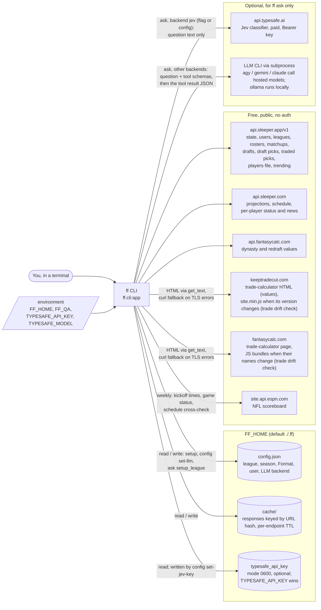
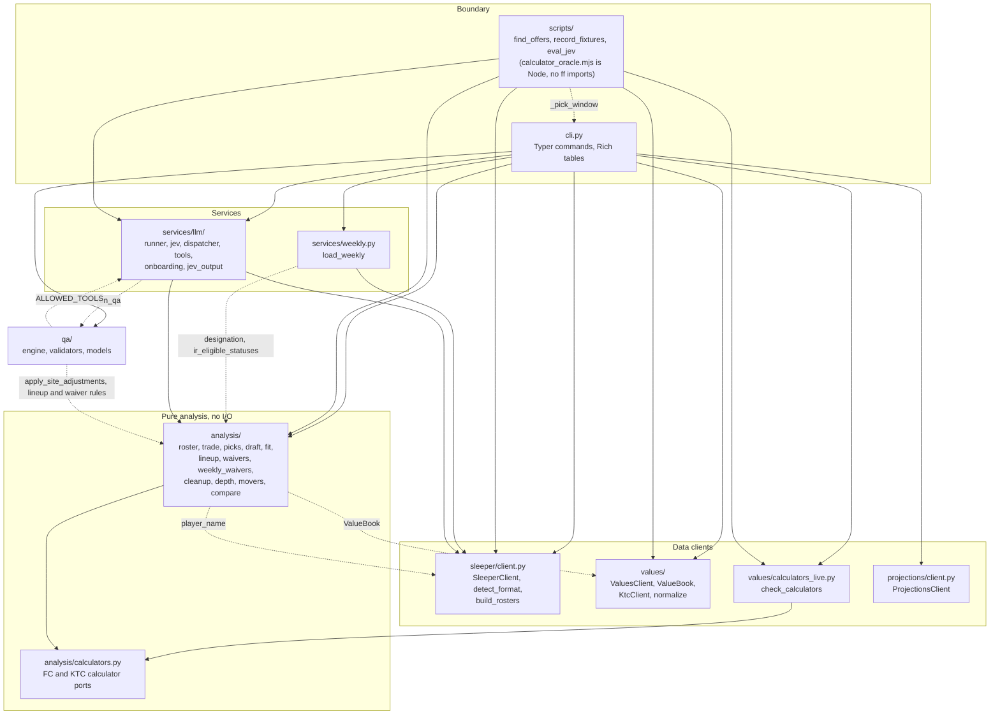
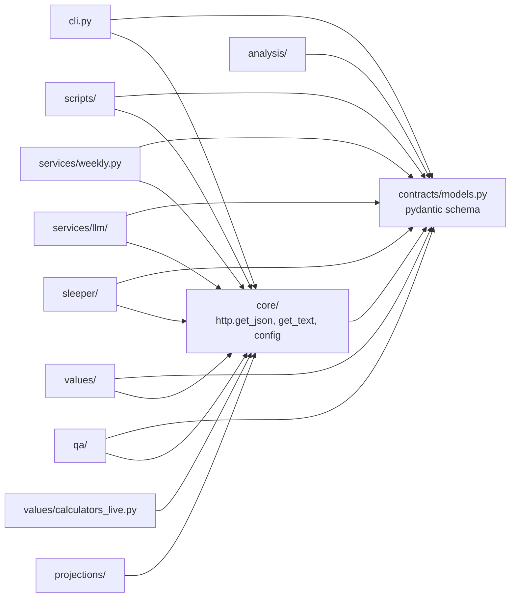
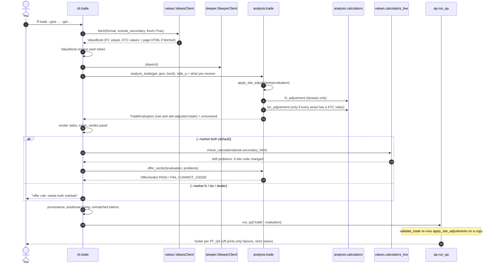
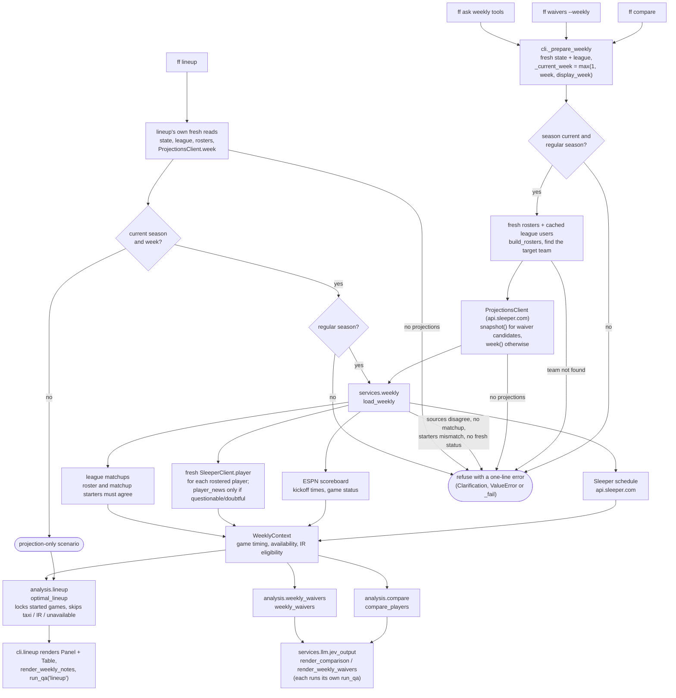
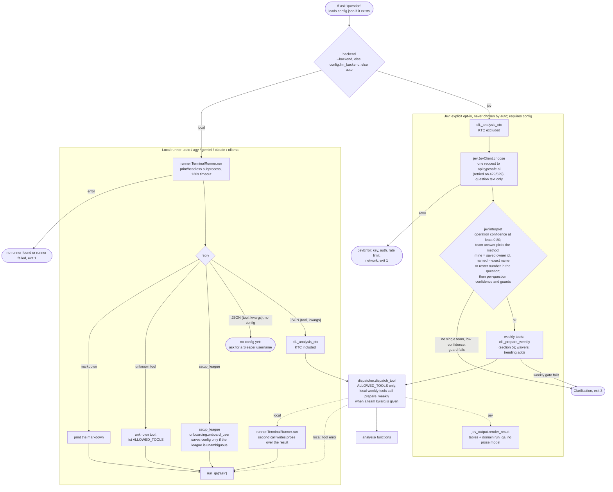

# Architecture diagrams

How `ff` is put together, from the outside in. These diagrams were derived from the source at commit `ba6e5b8`. Node labels use real module and function names, so you can grep them, and a rename should update this file. For the prose version and design decisions, see [`AGENTS.md`](../AGENTS.md) and [`.ai/specs/system-architecture.md`](../.ai/specs/system-architecture.md).

1. [System context](#1-system-context): what `ff` talks to and what it stores
2. [Module dependencies](#2-module-dependencies): the import graph between packages
3. [Command map](#3-command-map): which analysis each command runs and which providers it reads
4. [`ff trade`](#4-ff-trade): fresh prices, site adjustments, the offer rule
5. [Weekly decisions](#5-weekly-decisions): `lineup`, `compare`, `waivers --weekly`
6. [`ff ask`](#6-ff-ask): the local-runner and Jev paths

## 1. System context

`ff` is a local CLI. Every provider call is an HTTP GET; the only exception is the optional Jev POST. No command writes to Sleeper: nothing submits claims, changes lineups or executes trades. CLI state is local files under `FF_HOME`. (`scripts/record_fixtures.py` writes to `samples/`, outside it.)

## 2. Module dependencies

Package-level `import` edges under `src/ff/` and `scripts/`, read from the AST: every edge drawn has a backing import, and every import is drawn. The intended layering is boundary → services → data clients → pure analysis, with `qa` as a checker beside analysis and everything resting on contracts and core. Dashed edges are couplings that cut across that layering:

- analysis reaches back into `sleeper` (`player_name`) and `values` (`ValueBook`) for convenience
- `services.weekly` is a data loader, yet it reuses two rules from `analysis.cleanup`: `designation` and `ir_eligible_statuses`
- `qa` re-runs `analysis.trade.apply_site_adjustments`, reuses lineup and waiver rules (`SLOT_ELIGIBILITY`, `game_locked`, `unavailable`, `waiver_positions`), and reads the `services.llm.tools` allowlist
- `services.llm.jev_output` renders tables and runs QA, including for `compare` and `waivers --weekly`
- `scripts/find_offers.py` imports `ff.cli._pick_window`

`values/dealer.py` is a backward-compatibility shim that no command imports.

<!-- edges:begin -->

Nearly every package also imports the two shared ones. They are drawn separately so the graph above stays readable:

<!-- edges:end -->

## 3. Command map

Which analysis each command calls directly. Dotted edges inside the analysis box are imports between analysis modules, so `waivers` also runs `depth` and `fit` also runs `lineup`. `ask` reaches all of it through the dispatcher (section 6), but with cached values and without `trade`'s drift check or offer rule.

```mermaid
flowchart TD
  subgraph cmds["ff commands"]
    setup["setup"]
    cfgcmd["config set-llm<br/>config set-jev-key<br/>version"]
    rpn["roster<br/>power<br/>news"]
    picks_c["picks"]
    values_c["values"]
    trade_c["trade"]
    movers_c["movers"]
    waivers_c["waivers"]
    cleanup_c["cleanup"]
    draft_c["draft"]
    lineup_c["lineup"]
    compare_c["compare"]
    waiversw["waivers --weekly"]
    ask["ask"]
    qa_c["qa<br/>doctor (hidden alias)"]
  end

  cfgnote(["config.json /<br/>typesafe_api_key only"])
  detect["sleeper.detect_format"]
  top["ValueBook.top"]
  weekly["services.weekly<br/>load_weekly"]
  dispatch["services.llm.dispatcher<br/>dispatch_tool"]

  subgraph an["analysis/"]
    a_roster["roster"]
    a_picks["picks"]
    a_trade["trade"]
    a_calcs["calculators"]
    a_movers["movers"]
    a_waivers["waivers"]
    a_ww["weekly_waivers"]
    a_depth["depth"]
    a_cleanup["cleanup"]
    a_lineup["lineup"]
    a_compare["compare"]
    a_draft["draft"]
    a_fit["fit"]
  end

  cfgcmd -.-> cfgnote
  setup --> detect
  values_c --> top
  rpn --> a_roster
  picks_c --> a_roster
  picks_c --> a_picks
  trade_c --> a_trade
  movers_c --> a_movers
  waivers_c --> a_waivers
  cleanup_c --> a_cleanup
  draft_c --> a_draft
  draft_c --> a_fit
  draft_c --> a_roster
  lineup_c --> weekly
  lineup_c --> a_lineup
  compare_c --> weekly
  compare_c --> a_compare
  waiversw --> weekly
  waiversw --> a_ww
  ask --> dispatch
  qa_c --> a_roster
  qa_c --> a_picks
  qa_c --> a_cleanup
  qa_c --> a_waivers
  qa_c --> a_movers
  qa_c --> top

  weekly -.-> a_cleanup
  a_trade -.-> a_calcs
  a_waivers -.-> a_depth
  a_waivers -.-> a_lineup
  a_ww -.-> a_waivers
  a_ww -.-> a_lineup
  a_cleanup -.-> a_depth
  a_compare -.-> a_lineup
  a_fit -.-> a_lineup
  a_fit -.-> a_movers
```

What each command reads. `●` always; `◐` only in the noted case; blank means never. Every command except `setup`, `config set-jev-key` and `version` loads `config.json` first; `ask` loads it only if it exists. The last column is the `qa.engine.VALIDATOR_MAP` key that checks the result.

| Command | api.sleeper.app | api.sleeper.com | FantasyCalc | KTC | ESPN | TypeSafe | QA check |
|---|---|---|---|---|---|---|---|
| `setup` | ● state, user, leagues, league | | | | | | `setup` |
| `config set-llm`, `config set-jev-key`, `version` | | | | | | | none |
| `roster`, `power` | ● rosters, users, players | | ● | | | | `roster` / `power` |
| `picks` | ● rosters, users, league, drafts, traded picks, players | | ● | | | | `picks` |
| `values` | | | ● | ◐ unless `--market fc` (default `both`) | | | `values` |
| `trade` | ● players | | ● fresh | ◐ fresh, unless `--market fc` | | | `trade` |
| `movers` | ◐ rosters, users with `--arbitrage` | | ● | ◐ `--arbitrage` | | | `movers` |
| `waivers` | ● league, rosters, users, players, trending | | ● | | | | `waivers` |
| `waivers --weekly` | ● fresh state, league, rosters; users, players, matchups; ◐ trending with `--trending` | ● projections snapshot, schedule, rostered players' status; ◐ news for questionable/doubtful | | | ● | | `weekly_waivers` |
| `news` | ● rosters, users, players, trending adds and drops | | ● | | | | `news` |
| `cleanup` | ● league, rosters, users, players | | ● | | | | `cleanup` |
| `lineup` | ● fresh state, league, rosters; users, players; ◐ matchups, current week only | ● projections; ◐ schedule, rostered players' status and news, current week only | | | ◐ current week only | | `lineup` |
| `compare` | ● fresh state, league, rosters; users, players, matchups | ● projections, schedule, rostered players' status; ◐ news for questionable/doubtful | | | ● | | `compare` |
| `draft` | ● draft, draft picks, draft traded picks, rosters, users, players, league; ◐ drafts list unless `--draft-id` | | ● | | | | `draft` |
| `ask` (local runner) | ◐ per tool | ◐ weekly tools | ◐ value tools | ◐ value tools | ◐ weekly tools | | `ask` |
| `ask --backend jev` | ◐ per tool | ◐ weekly tools | ◐ value tools | | ◐ weekly tools | ● | per-tool domain check |
| `qa`, `doctor` | ● rosters, users, players, league, drafts, traded picks, trending | | ● | ● | | | up to 8 (`roster`, `cleanup` need your roster) |

`trade` with `--market both` also runs the calculator drift check: it fetches the `fantasycalc.com` trade-calculator page every run (plus its JS bundles when their names change), reuses the KTC page it already has, and downloads `keeptradecut.com/js/site.min.js` only when that version changes. The local `ask` runner's own network traffic belongs to the external binary and is invisible to `ff`.

## 4. `ff trade`

The one command that bypasses the cache for values (`fresh=True`): FantasyCalc always, KTC unless `--market fc`. It applies each site's own package adjustment before judging an offer. If the KTC fetch fails, the book simply has no KTC values; the error is swallowed, not raised.

## 5. Weekly decisions

Current-week advice is built from fresh reads (league users stay on their 30-minute cache), cross-checked and fail-closed. `ff compare`, `ff waivers --weekly` and every weekly `ask` route (lineup included) go through `cli._prepare_weekly`. The `ff lineup` command does its own fresh reads and calls `load_weekly` only for the current season and week. Any other week is a projection-only scenario with no injury or game-lock handling.

## 6. `ff ask`

Two interpreters share one deterministic back end, and the model never computes. Jev only answers fixed choices, and code builds the arguments. A local model picks the tool and its kwargs, then explains the result in prose. Either way the calculation runs in `analysis/` through `dispatch_tool`, which accepts only names in `services.llm.tools.ALLOWED_TOOLS`, against the same lazily loaded data as the structured commands (`cli._analysis_ctx`). Through `ask`, values come from the cache; `evaluate_trade` gets no drift check and no offer rule.

